# Confluent Kafka Real-Time E-commerce Checkout and Payment Pipeline using ksqlDB 

This project is a hands-on streaming data engineering lab built with **Confluent Cloud Kafka**, **ksqlDB**, and a **Python event producer**. It simulates e-commerce checkouts and payments, validates and correlates them in event time, and routes the resulting decisions to fulfillment, payment review, and an operational aggregation.

The pipeline is intended for learning and demonstration. The producer generates synthetic data; this is not a production payment-processing system.

## What the pipeline does

For each simulated order, the Python producer publishes a checkout event and then a payment event to separate Kafka topics. ksqlDB:

1. Reads both JSON topics as streams and assigns event time from each record's `event_ts`.
2. Normalizes and validates checkout and payment events.
3. Writes rejected checkout events to an audit/dead-letter topic.
4. Correlates valid checkouts and payments by `order_id` in a 10-minute event-time window, with a 2-minute grace period for late events.
5. Applies payment authorization, amount, currency, and fraud-score checks.
6. Routes ready orders to fulfillment and other matched orders to payment review.
7. Maintains a five-minute tumbling-window aggregate by shipping city and decision.

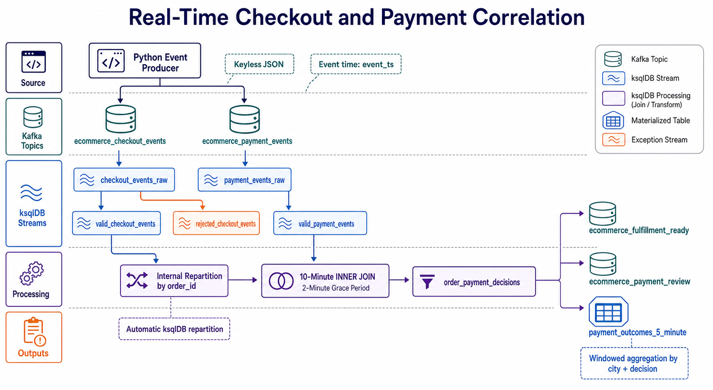

The producer publishes values without Kafka keys. The SQL join consequently relies on ksqlDB's automatic repartitioning by `order_id`; no user-created `PARTITION BY` stream is required for this join.

## Architecture and data flow

```text
Python producer
  ├── ecommerce_checkout_events
  │     └── CHECKOUT_EVENTS_RAW
  │           ├── VALID_CHECKOUT_EVENTS ───────────────┐
  │           └── REJECTED_CHECKOUT_EVENTS             │
  └── ecommerce_payment_events                        │
        └── PAYMENT_EVENTS_RAW                        │
              └── VALID_PAYMENT_EVENTS ───────────────┤
                                                       ▼
                                     ORDER_PAYMENT_DECISIONS
                                       ├── FULFILLMENT_READY_ORDERS
                                       ├── PAYMENT_REVIEW_ORDERS
                                       └── PAYMENT_OUTCOMES_5_MINUTE
```

The SQL creates the Kafka topics for its streams and table when they do not already exist. The included topic-list CSV is a point-in-time snapshot of a Confluent Cloud cluster, not a provisioning script or a guarantee of current cluster state.

## Repository contents

| File | Purpose |
|---|---|
| `ecommerce_event_producer.py` | Produces 30 synthetic checkout/payment pairs. |
| `kafka_checkout_payment_windowed_join.sql` | Ordered ksqlDB setup, validation, join, output streams, aggregate table, verification queries, and commented cleanup statements. |
| `requirements.txt` | Python producer dependencies: `confluent-kafka` and `Faker`. |
| `client.properties` | Local Kafka client configuration used by the producer. It contains credential fields; keep it private and do not copy credentials into documentation, source control, or logs. |
| `topics-list_lkc-pg6jxxk_2026-10-30T23_36_51.305Z.csv` | Exported topic inventory from one cluster snapshot. |
| `test.ipynb` (currently absent) | This separate pandas practice notebook was readable during the initial review, where it demonstrated DataFrame creation, row iteration, and conversion of rows to dictionaries. It was no longer present during final folder verification. It is unrelated to the Kafka pipeline, and pandas is not listed in the producer requirements. |

### Screenshots and diagrams

The images below are grouped by pipeline stage. They document example producer activity and Confluent Cloud UI state; they are illustrative snapshots, while the SQL file remains the executable source of truth. Expand a stage to view its screenshots.

<details>
<summary>Producer and source topics</summary>

**Producer events and Confluent Cloud topic inventory**

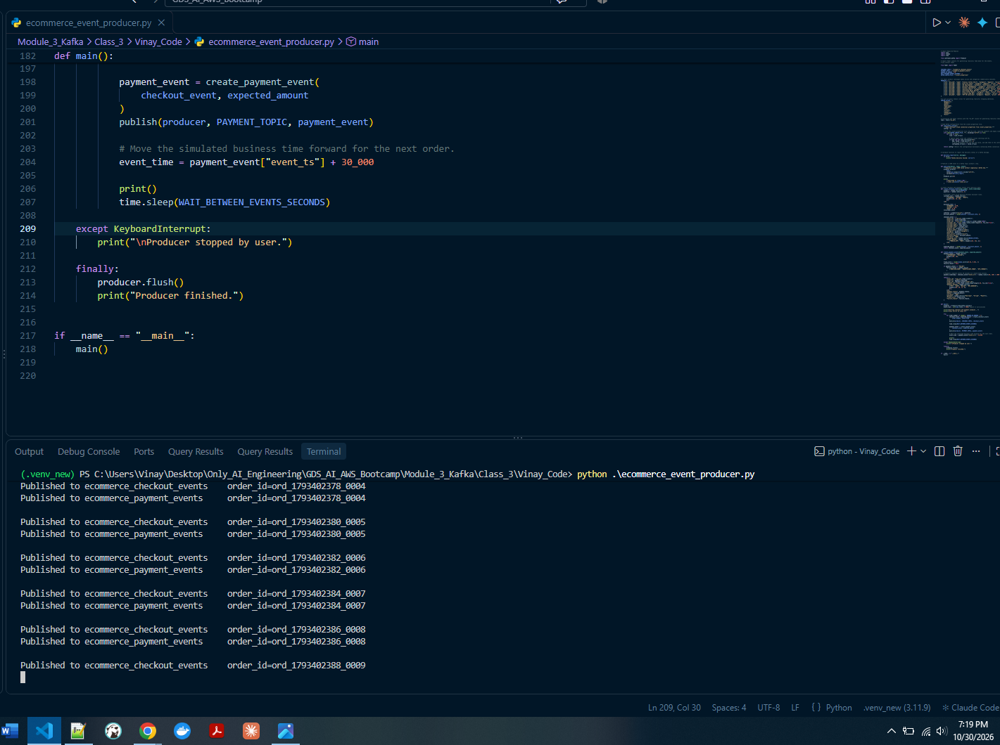

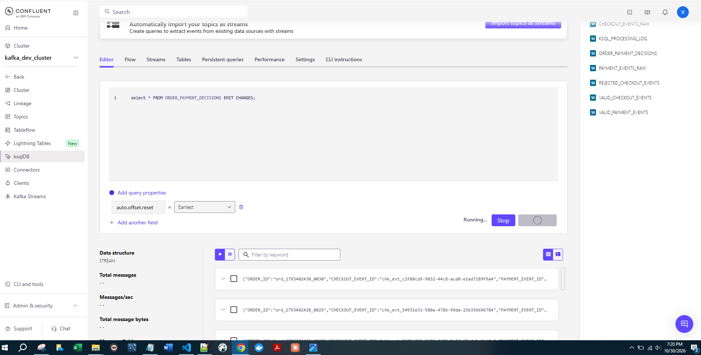

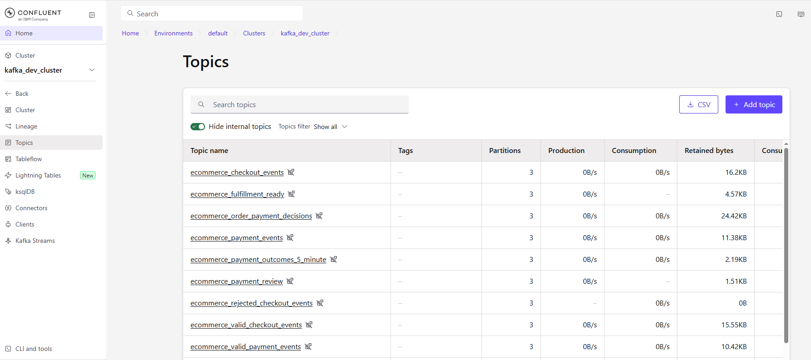

**Example checkout and payment messages**

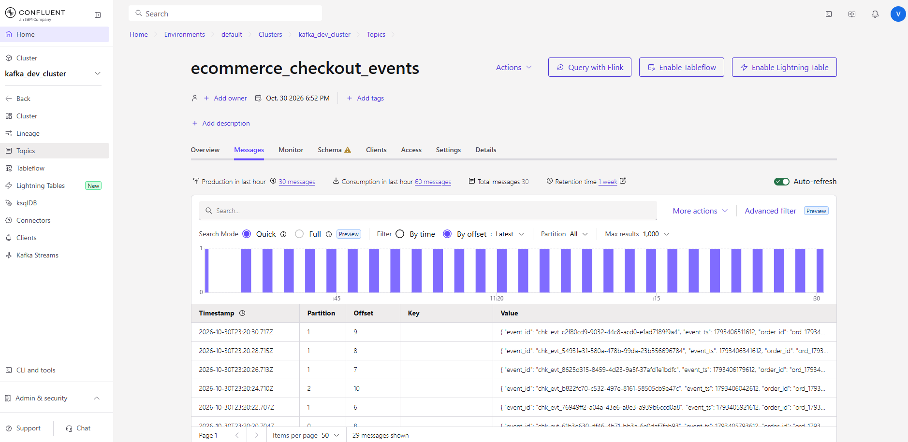

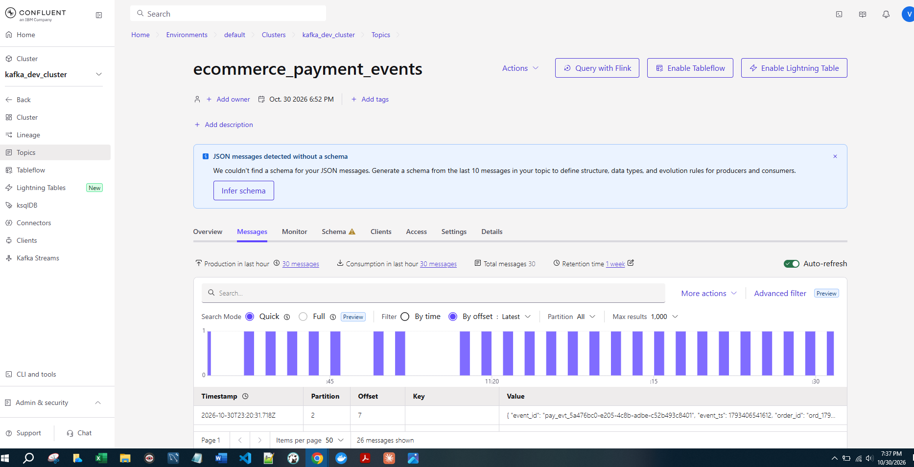

</details>

<details>
<summary>Validation and order-payment decisions</summary>

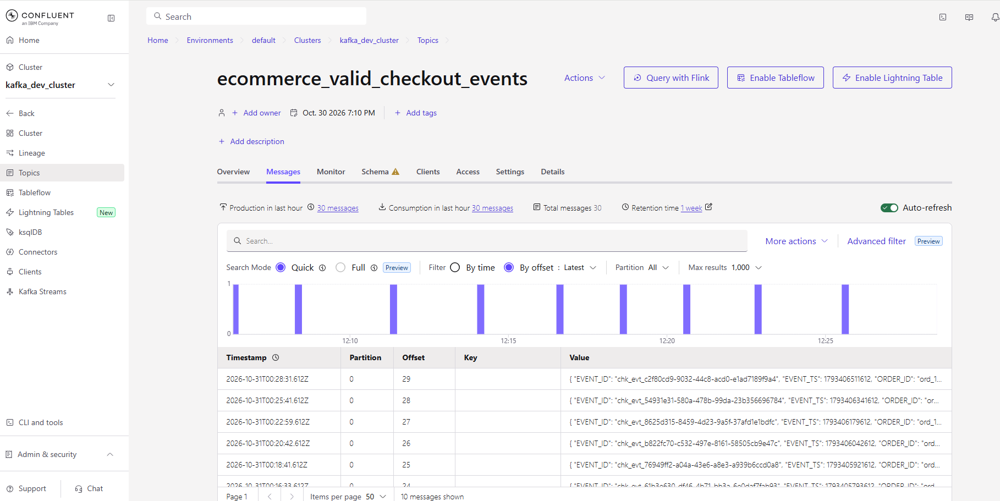

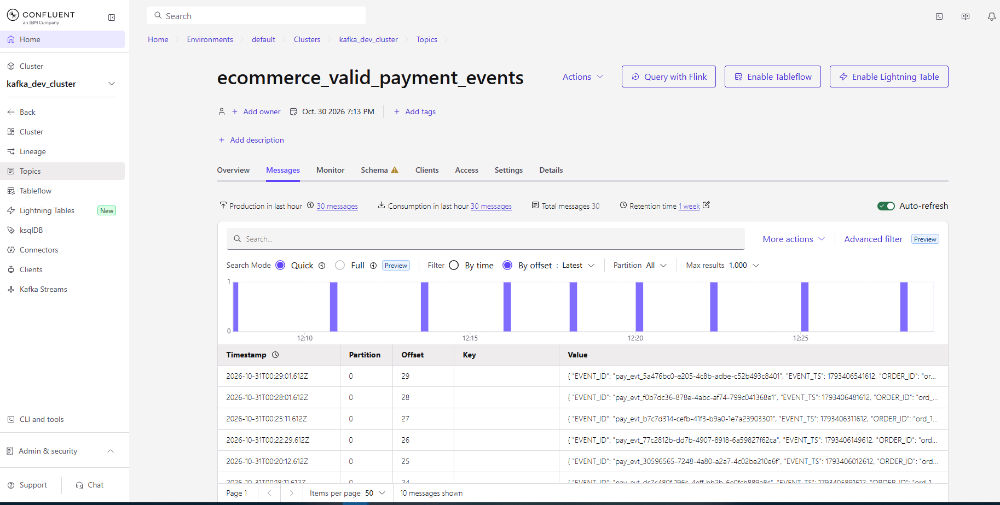

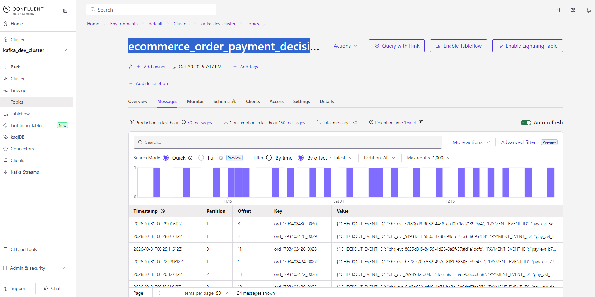

</details>

<details>
<summary>Fulfillment, payment review, and aggregate outputs</summary>

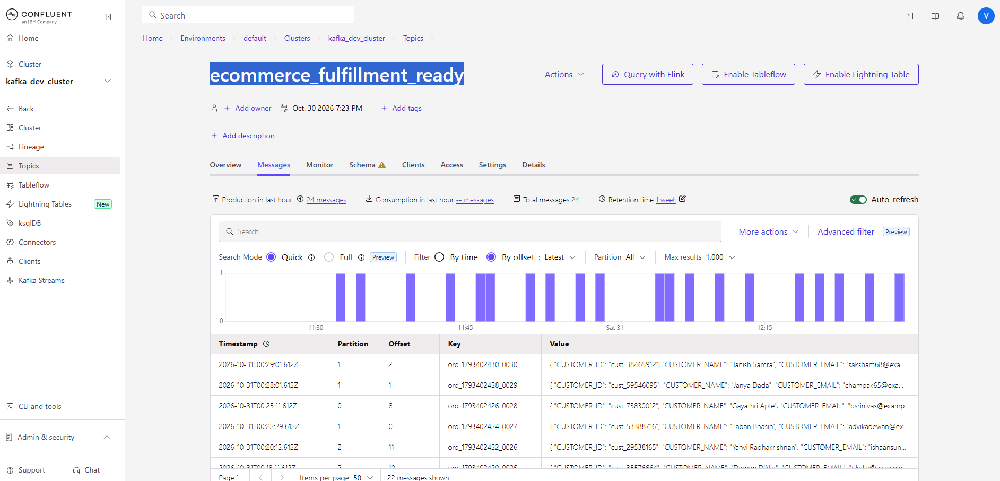

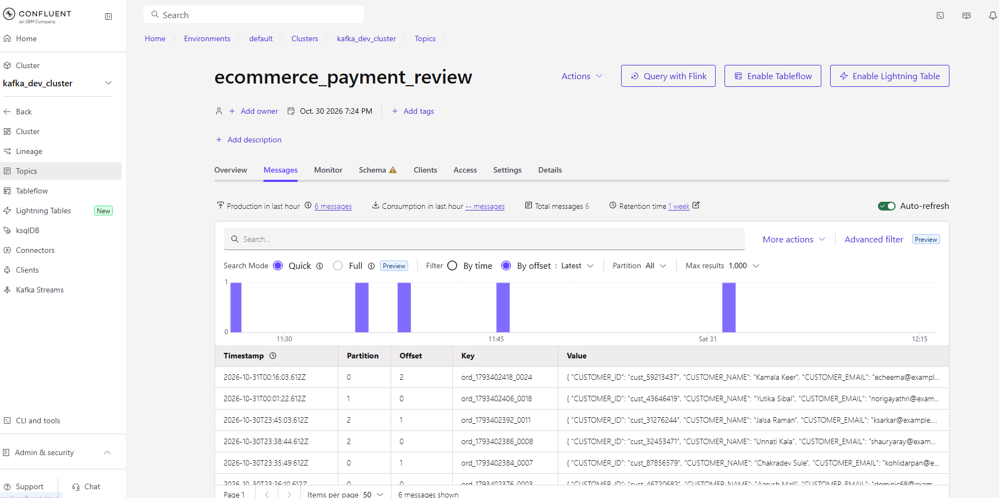

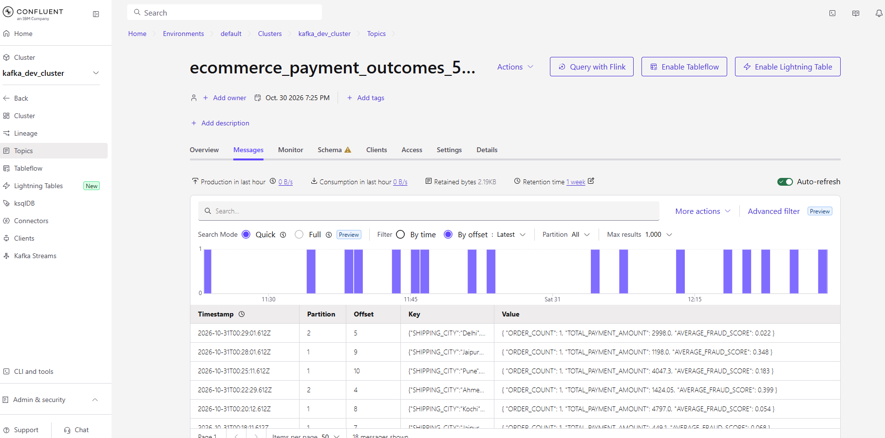

</details>

<details>
<summary>ksqlDB objects, persistent queries, and lineage</summary>

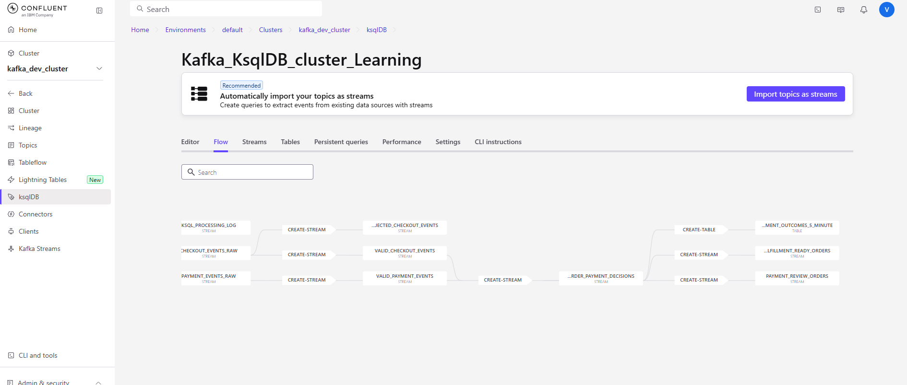

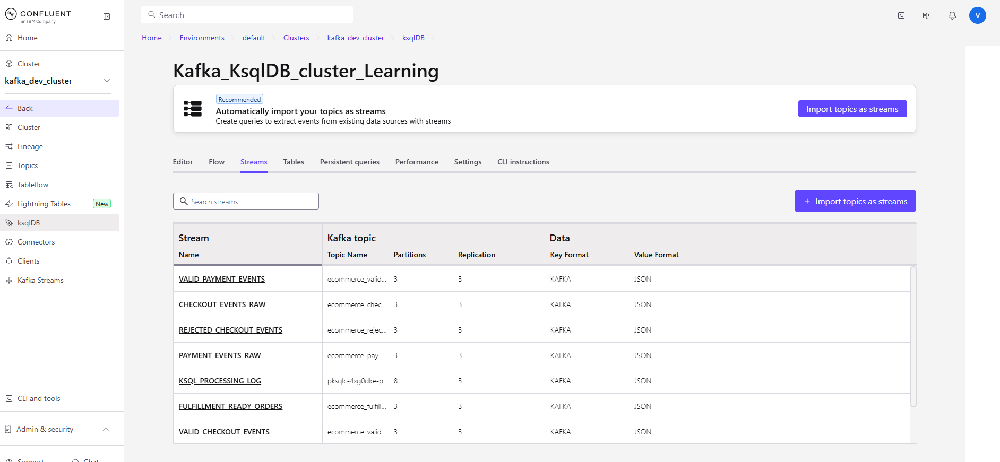

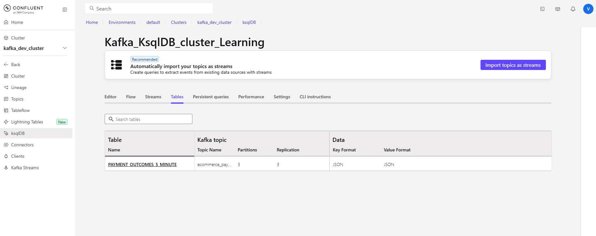

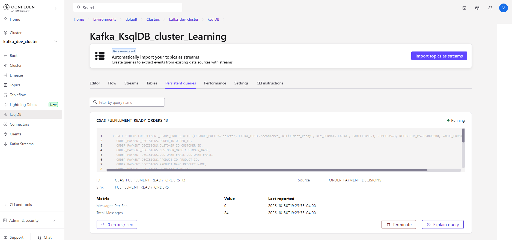

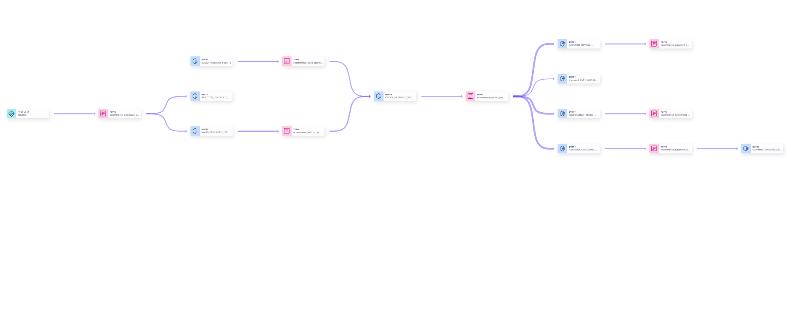

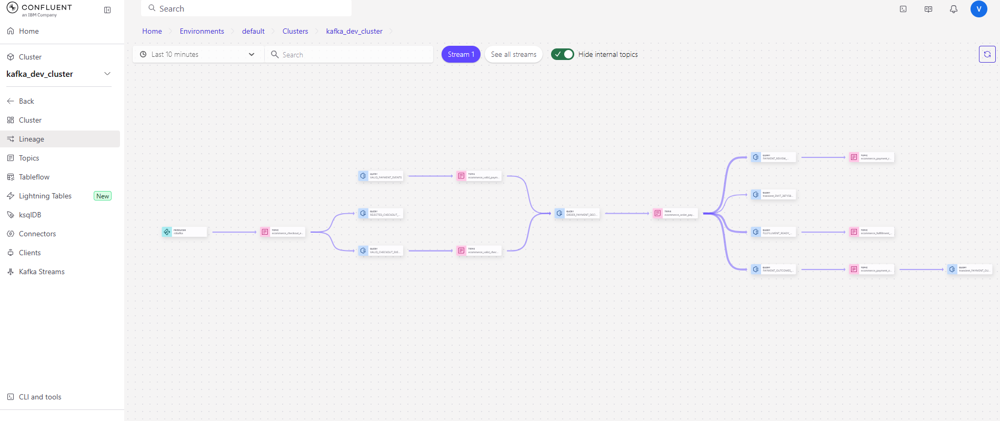

</details>

## Data contracts

The producer serializes event values as UTF-8 JSON. It does not set a Kafka message key. The source stream declarations in the SQL define the field types and use `event_ts` (Unix epoch milliseconds) as the event-time timestamp.

### Checkout event

Each checkout includes:

- Identity and timing: `event_id`, `event_ts`, `order_id`
- Customer: `customer_id`, `customer_name`, `customer_email`, `customer_tier`
- Item and pricing: `product_id`, `product_name`, `category`, `quantity`, `unit_price`, `discount_amount`, `currency`
- Fulfillment context: `shipping_city`, `sales_channel`

The producer chooses from a small product catalog, Indian cities, customer tiers, and sales channels. It calculates `expected_amount` as `(quantity * unit_price) - discount_amount`; ksqlDB derives this field in the validated stream rather than expecting it in the source event. It also derives an `order_value_band` of `HIGH` (at least 20,000), `MEDIUM` (at least 5,000), or `STANDARD`.

### Payment event

Each payment includes:

- Identity and timing: `event_id`, `event_ts`, `order_id`, `payment_id`
- Payment details: `payment_method`, `payment_status`, `amount`, `currency`, `gateway`
- Risk and failure details: `fraud_score`, `failure_reason`

The generated payment amount matches the checkout's expected amount. Payment status is randomly `AUTHORIZED` (90% weighting) or `FAILED` (10% weighting); failed events receive a simulated reason. Fraud scores are generated from 0.02 to 0.40, so the producer's synthetic data does not exercise the join rule's high-risk threshold of 0.80.

## Topic and ksqlDB object inventory

The SQL configures three partitions for application topics. The CSV snapshot also shows three partitions for these application topics.

| ksqlDB object | Kafka topic | Type / role |
|---|---|---|
| `CHECKOUT_EVENTS_RAW` | `ecommerce_checkout_events` | Source checkout stream. |
| `PAYMENT_EVENTS_RAW` | `ecommerce_payment_events` | Source payment stream. |
| `VALID_CHECKOUT_EVENTS` | `ecommerce_valid_checkout_events` | Normalized, valid checkout events with expected amount and value band. |
| `REJECTED_CHECKOUT_EVENTS` | `ecommerce_rejected_checkout_events` | Invalid checkouts with a `rejection_reason`. |
| `VALID_PAYMENT_EVENTS` | `ecommerce_valid_payment_events` | Normalized, valid payment events. |
| `ORDER_PAYMENT_DECISIONS` | `ecommerce_order_payment_decisions` | Joined events with decision, readiness flag, and event-time metadata. |
| `FULFILLMENT_READY_ORDERS` | `ecommerce_fulfillment_ready` | Approved matched orders and `ALLOCATE_INVENTORY` action. |
| `PAYMENT_REVIEW_ORDERS` | `ecommerce_payment_review` | Matched orders requiring review and a recommended next action. |
| `PAYMENT_OUTCOMES_5_MINUTE` | `ecommerce_payment_outcomes_5_minute` | Materialized five-minute aggregate by `shipping_city` and `decision`. |

The exported CSV also contains `orders_raw` and a `pksqlc-...-processing-log` topic. `orders_raw` is outside this pipeline (and is marked as having a schema in that snapshot); the `pksqlc-...` entry is a ksqlDB processing-log topic. Do not treat either as an application output created by this SQL file.

## Business and data-quality rules

### Checkout validation

A checkout is accepted only when:

- `order_id` and `customer_id` are present.
- `quantity` and `unit_price` are positive.
- `discount_amount` is nonnegative and less than the item subtotal.
- `currency` is present.

Invalid checkout records are sent to `ecommerce_rejected_checkout_events`. The reason is selected in priority order, such as `MISSING_ORDER_ID`, `INVALID_QUANTITY`, `DISCOUNT_EXCEEDS_SUBTOTAL`, or `MISSING_CURRENCY`. The SQL does not define a separate rejected-payment stream; invalid payments are filtered out of `VALID_PAYMENT_EVENTS`.

### Payment validation and decision

A payment is accepted into the valid stream only if `order_id`, `payment_id`, positive `amount`, `currency`, and `payment_status` are present, and `fraud_score` is between 0.0 and 1.0.

The join emits only matched checkout/payment pairs. A matched order is fulfillment-ready only when all of the following hold:

- `payment_status = 'AUTHORIZED'`
- Checkout and payment currencies match.
- Absolute difference between expected and paid amounts is no more than 1.0 (rounding tolerance).
- `fraud_score < 0.80`

Decision values are `PAYMENT_NOT_AUTHORIZED`, `CURRENCY_MISMATCH`, `AMOUNT_MISMATCH`, `HIGH_FRAUD_RISK`, and `READY_FOR_FULFILLMENT`.

| Decision/outcome | Output |
|---|---|
| Ready | `ecommerce_fulfillment_ready`, with `next_action = ALLOCATE_INVENTORY`. |
| Not ready | `ecommerce_payment_review`, with a next action such as `SEND_TO_FRAUD_TEAM`, `VERIFY_ORDER_TOTAL`, `VERIFY_CURRENCY`, or `RETRY_OR_CONTACT_CUSTOMER`. |
| Any matched decision | Included in the five-minute city/decision aggregate. |

Because this is an `INNER JOIN`, checkouts without a matching payment and payments without a matching checkout do not appear in the decision or review streams. The project does not currently implement an unmatched-event timeout or a separate payment dead-letter path.

## Prerequisites

- A Confluent Cloud Kafka cluster and an associated ksqlDB application/environment that can access it.
- Kafka API credentials with permission to produce to the source topics.
- A compatible local Python installation. The included notebook metadata identifies Python 3.11.9 as its kernel; use that version for a convenient baseline.
- Network access from the machine running the producer to the Kafka bootstrap endpoint.

Cloud resources can incur charges depending on account, cluster, region, and current pricing. Check the active plan and resource usage before creating or leaving resources running.

## Setup

### 1. Configure Kafka credentials

The producer reads `client.properties` from its **current working directory**. The file is already present in this folder. Its required properties are:

```properties
bootstrap.servers=<YOUR_BOOTSTRAP_SERVER>
security.protocol=SASL_SSL
sasl.mechanisms=PLAIN
sasl.username=<YOUR_KAFKA_API_KEY>
sasl.password=<YOUR_KAFKA_API_SECRET>
```

Use the broker endpoint and API key/secret for the correct Confluent Cloud cluster. Do not replace working credentials with placeholders, and do not publish the real values. Restrict access to this local file and ensure it is excluded from any source-control upload or shared archive. Rotate the key if it has been exposed.

### 2. Create and activate a Python environment

In PowerShell, from this project directory:

```powershell
py -3.11 -m venv .venv
.\.venv\Scripts\Activate.ps1
python -m pip install -r requirements.txt
```

If PowerShell prevents environment activation, use the Python executable in `.venv\Scripts\python.exe` directly or follow your organization's policy for script execution. The producer dependencies are `confluent-kafka` and `Faker`; the notebook is separate and may require pandas if you choose to run it.

## Run the pipeline

### 1. Start the ksqlDB definitions

1. Open the ksqlDB editor for the Confluent Cloud cluster.
2. Open `kafka_checkout_payment_windowed_join.sql`.
3. Run the statements in numbered order, starting with section 0. Run statements individually or in small dependency-ordered groups.
4. Let the `CREATE ... AS SELECT ... EMIT CHANGES` statements start successfully before moving to downstream definitions.
5. Confirm the objects with the `SHOW STREAMS`, `SHOW TABLES`, and `SHOW QUERIES` commands near the end of the file.

The `CREATE ... AS SELECT` statements create persistent queries that continue running after the editor command returns. They are not one-time batch jobs. The sample `SELECT ... EMIT CHANGES` statements are push queries that remain open until cancelled; execute them individually and cancel them when finished. The `SELECT * FROM payment_outcomes_5_minute` statement is a pull query that returns the current materialized snapshot.

`SET 'auto.offset.reset' = 'earliest'` is included at the beginning so a newly started query can read retained source records from the beginning when it has no committed offsets. This does not reset offsets for an already-running or previously committed persistent query.

### 2. Produce events

Run the producer from the project directory so its relative `client.properties` path resolves:

```powershell
python .\ecommerce_event_producer.py
```

The script sends 30 checkout/payment pairs to `ecommerce_checkout_events` and `ecommerce_payment_events`, with a one-second pause between sends. Press `Ctrl+C` to stop early. The producer flushes queued messages on exit.

Each pair is published checkout first, then payment. The payment's `event_ts` is 30 to 180 seconds later than its checkout. After each payment, the producer advances the simulated business clock by another 30 seconds for the next order; event time therefore advances faster than wall-clock time.

### 3. Verify output

In ksqlDB, run or inspect:

```sql
SHOW STREAMS;
SHOW TABLES;
SHOW QUERIES;

SELECT * FROM order_payment_decisions EMIT CHANGES;
SELECT * FROM fulfillment_ready_orders EMIT CHANGES;
SELECT * FROM payment_review_orders EMIT CHANGES;
```

To inspect aggregate updates:

```sql
SELECT
    WINDOWSTART,
    WINDOWEND,
    shipping_city,
    decision,
    order_count,
    total_payment_amount,
    average_fraud_score
FROM payment_outcomes_5_minute
EMIT CHANGES;
```

Alternatively, run `SELECT * FROM payment_outcomes_5_minute;` for the current table snapshot. The Confluent Cloud Topics UI can also be used to inspect source, derived, and output topic messages; the included screenshots show representative topic and lineage views.

## Operational notes and troubleshooting

- **Authentication/connection errors:** Confirm the current working directory, `client.properties` path, bootstrap endpoint, API key, secret, and cluster permissions. Never paste credential values into chat or logs.
- **No messages in the source topics:** Confirm the producer started without a configuration error and inspect its delivery-failure output. Verify the topic names and Kafka cluster in both the client configuration and ksqlDB.
- **No decisions:** Confirm both valid streams are receiving events, their records share the same `order_id`, and source event timestamps are within the join window. The join is based on `event_ts`, not broker arrival time.
- **Records absent from valid streams:** Check the validation predicates in the SQL and inspect `ecommerce_rejected_checkout_events` for checkout rejection reasons. Invalid payments are filtered without a dedicated rejected topic.
- **Persistent query already exists:** Inspect `SHOW QUERIES` before rerunning a `CREATE ... AS SELECT`. These statements are persistent and are not intended to be blindly executed repeatedly. Use the query ID shown by ksqlDB when managing an existing query.
- **Unexpected or old results:** Review the query's offsets and state. `auto.offset.reset = earliest` only applies when a query has no established offset; it is not a replay command.
- **Schema or SQL errors:** Check that the selected ksqlDB application is connected to the expected Kafka cluster and that the source payload fields and types match the declarations at the top of the SQL file.
- **No output for an order:** The join is inner, and unmatched input records are intentionally absent from the decision output. Also verify the decision routing predicates and event-time interval.

## Cleanup and reset

The SQL file contains optional, commented `TERMINATE QUERY` and `DROP` statements. Cleanup is destructive: dropping with `DELETE TOPIC` removes the associated Kafka topic and its retained records. Before a reset:

1. Inspect `SHOW QUERIES` and identify only the persistent queries created for this lab.
2. Terminate those queries using their actual deployment-specific IDs.
3. If you intend to delete topics, confirm that their data is no longer needed and then uncomment/run the relevant drop statements in reverse dependency order.

Do not run the cleanup block as part of normal setup. Preserve any records or topics needed for other exercises.

## Known scope and limitations

- This is a demonstration pipeline with synthetic data, not a production payment or fulfillment integration.
- There is no schema registry integration for the ecommerce events; JSON is used directly.
- The producer uses keyless JSON messages, and the join requires ksqlDB-managed repartitioning.
- The inner join has no explicit unmatched-event handling or timeout output.
- Only checkout validation has a rejected-record topic.
- The generated fraud scores are below the SQL high-risk threshold, so adjust test data deliberately if you need to demonstrate that branch.
- The five-minute aggregate is event-time windowed and includes a two-minute grace period; results update as records arrive and windows close.
- The topic CSV and UI screenshots describe a historical cluster snapshot and may differ from the current cloud environment.
